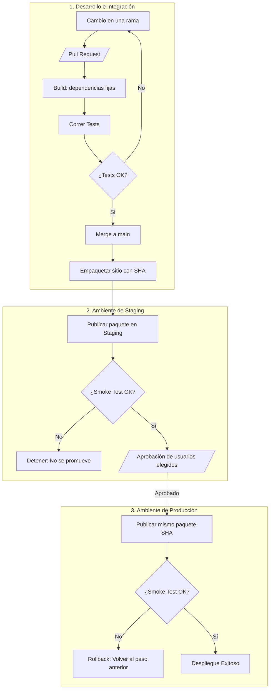

# Mapa de estrategia CI/CD - API de tareas

> Autor o autora: Mario Sanchez Caracas
> Punto de partida: `docs/DESPLIEGUE_MANUAL.md`, el proceso manual que el pipeline va a reemplazar.
> Cómo se ve un mapa terminado: `docs/ejemplo-mapa-cicd-sitio.md` (otro caso, mismo método).
> Sintaxis de los diagramas: la Guía rápida de Mermaid (Moodle, material de apoyo).

## 1. Flujo de commit a producción

## 2. Ambientes

| Ambiente         | Para qué sirve                                                                 | Cómo llega un cambio                                      | Quién decide que llegue    |
| :--------------- | :----------------------------------------------------------------------------- | :-------------------------------------------------------- | :------------------------- |
| **Desarrollo**   | Espacio de trabajo diario donde se crea e integra nuevo código.                | El desarrollador sube un cambio al repositorio.           | El desarrollador.          |
| **Pruebas (QA)** | Entorno aislado para ejecutar pruebas y detectar errores antes de publicar.    | Se despliega al terminar una funcionalidad en desarrollo. | Tech Lead o equipo de QA.  |
| **Staging**      | Réplica de producción usada para validar rendimiento y aprobación del negocio. | Se promueve la versión aprobada desde QA.                 | El equipo de QA.           |
| **Producción**   | Entorno real y público donde los usuarios finales utilizan el producto.        | Despliegue controlado tras validar todo en staging.       | Product Owner y Tech Lead. |

## 3. Riesgos del proceso manual y controles

Un renglón por riesgo. La columna "Paso" cita el paso de `DESPLIEGUE_MANUAL.md`.

| Paso                                        | Riesgo                                         | Qué puede pasar                                                                           | Control del pipeline que lo atiende                                                             | Etapa del flujo                |
| :------------------------------------------ | :--------------------------------------------- | :---------------------------------------------------------------------------------------- | :---------------------------------------------------------------------------------------------- | :----------------------------- |
| **Confirmar pruebas por chat**              | Validación informal sin trazabilidad.          | Se despliega código roto por un malentendido humano.                                      | Ejecución automática de pruebas unitarias y de integración que bloquean el avance si fallan.    | Integración Continua (CI) / QA |
| **Avisar caída de la API**                  | Tiempo de inactividad planificado (Downtime).  | Los usuarios sufren interrupciones y pérdida de peticiones activas.                       | Despliegue sin tiempo de inactividad (_Zero-Downtime_ como _Blue/Green_ o _Rolling Update_).    | Despliegue (CD) / Producción   |
| **Clave del servidor en un correo**         | Exposición de credenciales críticas.           | Acceso no autorizado al servidor si se filtra el correo.                                  | Autenticación mediante llaves SSH gestionadas por el runner o roles IAM sin contraseñas.        | Seguridad / Infraestructura    |
| **Ejecutar `git pull` o borrar carpeta**    | Desincronización y pérdida de estado.          | Se pierden logs locales, archivos temporales o se despliega código sin compilar.          | Uso de artefactos inmutables (ej. imágenes Docker) construidos una sola vez antes de desplegar. | Build / Empaquetado            |
| **`pip install` sin versiones fijas**       | Dependencias inconsistentes.                   | Se instala una versión nueva de Flask/Gunicorn que rompe la aplicación.                   | Uso de archivo `requirements.txt` con versiones exactas y entornos aislados.                    | Build / Empaquetado            |
| **`export API_TOKEN` en consola**           | Fuga de secretos en el historial del servidor. | El token queda visible en el historial de comandos (`history`) y se pierde al reiniciar.  | Inyección segura de variables de entorno desde un gestor de secretos (Vault, AWS Secrets).      | Configuración / Despliegue     |
| **Probar abriendo una URL en el navegador** | Validación superficial.                        | La página carga, pero funciones internas críticas están fallando silenciosamente.         | _Health checks_ automatizados y pruebas _Smoke_ post-despliegue.                                | Verificación / Staging y Prod  |
| **Rollback buscando el commit anterior**    | Recuperación lenta y propensa a errores.       | Se tarda mucho en restaurar el servicio mientras se averigua cuál era la versión estable. | Rollback automático en un clic hacia el artefacto o imagen anterior etiquetada.                 | Recuperación / Producción      |

## 4. Criterios de éxito

Qué tiene que ser verdad para decir que un despliegue salió bien, de forma que una máquina lo
pueda comprobar.

- Health check exitoso. El endpoint responde con un código HTTP 200 OK.
- Pruebas Smoke aprobadas como: crear, leer o autenticar
- Latencia de la respuesta. El tiempo de respuesta promedio de la API se mantiene dentro del rango esperado

## 5. Decisiones y preguntas abiertas

- ¿Cómo se va a empaquetar y correr la aplicación? si se contempla la posibilidad de usar contenedores

## 6. Declaracion del uso de la IA

- Se uso la IA para revision de la sintaxis del documento y para contrastar ideas
